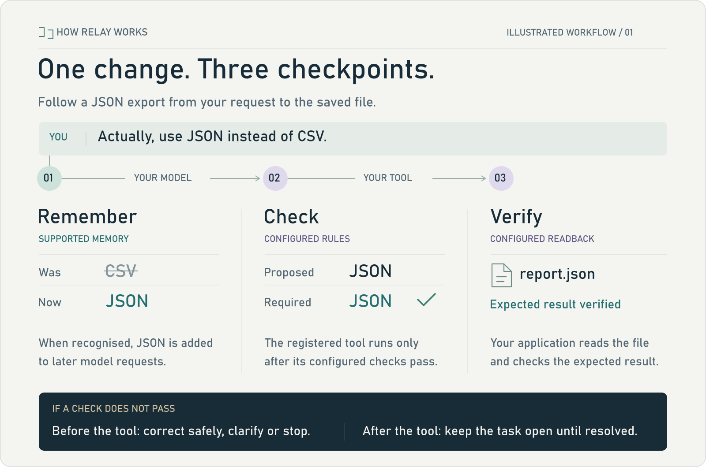

<div align="center">

# Context Relay

Instruction memory and tool checks for Python agents.

[](https://github.com/mahekara28/context-relay/actions/workflows/alpha.yml)
[](docs/ALPHA.md)
[](pyproject.toml)
[](LICENSE)

[Install](#install) · [Connect](#quick-start) · [How it works](#how-it-works) · [Integrations](#integrations) · [Limits](#limits-and-trust)

</div>


**Public alpha · v0.22.0a3.** See the [current limits](#limits-and-trust) before choosing Relay for your workflow.

## Why Relay?

You ask an agent to export a report as CSV. A few messages later, you say,
“Actually, use JSON instead of CSV.” The conversation moves on, and the agent still
tries to write CSV.

Relay is built around this problem. It keeps supported preference changes
separate from the chat history and includes the current values in later model
requests. You can also register an export tool and have Relay check its arguments
against those values before it runs.

It fits into your existing Python project, alongside your model and framework.
If your framework already remembers preferences and validates these actions,
compare that setup with Relay before adding another library. The useful test is
whether it helps your agent finish the work correctly.

## Install

Use **Python 3.10+** in your project's environment. This alpha is **not on PyPI**;
install the wheel included in the repository:

```sh
git clone https://github.com/mahekara28/context-relay.git
cd context-relay
python -m pip install --no-index --no-deps dist/context_relay_local-0.22.0a3-py3-none-any.whl
python -m context_relay quickstart
```

The last command should print `Offline connection check: PASSED` and show a
preference changing from CSV to JSON. It uses a local stand-in, so you can check
the connection without an API key or a model. It does not test an AI's accuracy.

After cloning, these commands work offline. Relay's core has no runtime
dependencies and makes no extra model calls by default. Your provider keeps its
usual costs when you connect a real model.

<details>
<summary>Install from source or open the local demo</summary>

From the cloned repository:

```sh
python -m pip install .
python run.py serve
```

Source installation may download build tools. Open the demo at
`http://127.0.0.1:8765`; your project does not need this UI to use Relay.
For a complete Python example without a model, see
[automatic_connection.py](examples/automatic_connection.py).

</details>

<a id="connect-to-your-agent"></a>

## Quick start

Pass the client your project already uses, then send requests through Relay:

```python
from context_relay import auto_connect

with auto_connect(existing_client, conversation="report-42") as ai:
    response = ai(messages=full_history, model=your_model)
    # Reuse this connection for the conversation's later requests.
```

`existing_client`, `full_history` and `your_model` are your application's values.
Keep your usual provider options; Anthropic also needs `max_tokens`.
Async clients use `async with` and `await ai(...)`.

Keep one connection per conversation. On each call, pass the **full original
message history**, adding new messages without rewriting earlier ones. For a
simple chat with complete text replies, `ai.conversation()` can manage that
history for you.

The conversation name saves memory locally. Reuse the name and storage location
to continue after a restart; leave it out for temporary memory. Calls through the
original client bypass Relay. Closing Relay leaves that client open.

A disputed preference can pause a call with `MemoryClarificationRequired`.
[Handle the question in your UI](docs/INSTRUCTION_CLARIFICATION.md), then add the
user's answer to the history. The [connection guide](docs/AUTO_CONNECT.md) and
[persistence guide](docs/NAMED_MEMORY.md) cover the full setup.

## How it works

The full workflow follows the instruction all the way to the saved result:



Connecting a client enables basic memory. To use the whole path, register your
tools, choose the rules they must follow, and provide a function that checks the
result. Your application still decides who can act and which sources to trust.

<details>
<summary>Read the walkthrough and failure paths</summary>

1. **Remember.** When Relay recognises the correction, it adds the current JSON
   preference to later model requests.
2. **Check.** The model proposes an export. Relay checks the registered action
   against your rules and permissions before the tool runs. An optional repair
   can supply a known valid replacement and check the proposal again. Otherwise,
   the workflow asks for clarification or stops.
3. **Verify.** Your application reads the destination and checks the expected
   result. A mismatch leaves the task unfinished. Missing evidence leaves the
   outcome unresolved.

Relay never automatically repeats an action that has started. A successful
result check covers the conditions you defined.

</details>

For a working example with real file writes, see
[Verified Release Desk](examples/verified_release_desk.py) and its
[setup guide](docs/PROTECTION_PROFILE.md). For stricter workflows, you can
[require instruction review](docs/INSTRUCTION_ASSURANCE.md),
[check fresh source data](docs/PROTECTION_PROFILE.md#check-the-source-and-the-destination), or
[continue a long task across history segments](docs/WORKFLOW_CONTINUATION.md).

## Improve a workflow from its failures

Relay can now test a proposed configuration change against your existing setup.
`improve_harness()` gives your proposal function the failed development examples,
then tests its suggestion on the full case set, including separate holdout cases.
It keeps the original configuration if the candidate makes a wrong action, breaks
a previously completed task, exceeds its call budget or fails to improve completion.

Try the offline example:

```sh
python examples/harness_improvement.py
```

It uses Relay's protected export tool and reads back real temporary files. The
responses are fixed test cases, so this demonstrates the mechanism, not model
accuracy. The selected configuration is returned for your application to review
and adopt. Relay does not rewrite live code or train the model.
[Connect your own workflow](docs/HARNESS_EVALUATION.md).

## Integrations

| Your project uses | Relay supports |
| --- | --- |
| Python functions | Sync and async callables that accept plain message dictionaries. |
| Ollama | Text and supported tool-message histories. |
| OpenAI | Chat Completions by default; explicit adapters for supported Responses formats. |
| Anthropic | Plain-text Messages by default; explicit adapters for supported native blocks. |
| LangChain / LangGraph | An optional chat-model bridge alongside framework checkpoints. |

Native OpenAI and Claude modes **do not extract preferences by default**.
They need explicit history and memory handling. The complete guarded workflow is
currently synchronous and handles one supported function call per response.
Streaming, parallel actions and other native formats have limits; check the
[connector guide](docs/AUTO_CONNECT.md) and
[workflow support](docs/RESPONSES_WORKFLOW.md) for your setup.

## Limits and trust

- **It can miss instructions.** In a separate wording test, the default parser
  recognised only **1 of 11 clear changes** and missed both unclear cases.
  Optional instruction review asks for a decision on selected fields on every
  new user turn, even when nothing changed. That adds a manual check, not better
  language understanding. [Test details](docs/VALIDATION.md).
- **Checks cover what you define.** Relay cannot judge every explanation or
  business decision. Wrong source data or a wrong verification rule can still
  produce a wrong result. Only calls through Relay and its registered tools
  receive these checks.
- **A completed tool call may still need attention.** Reading back the result
  cannot undo a bad write. Your destination needs its own protection against
  duplicate writes and conflicting updates. [Recovery guide](docs/RESPONSES_WORKFLOW.md#results-and-recovery).
- **Storage is local and bounded.** Persistent memory uses plaintext SQLite.
  Deletion does not guarantee physical erasure, and distributed or high-load
  reliability has not been established. Starting a fresh history segment leaves
  older reasoning out of the model's input; archived details must be retrieved
  when needed. [Storage](docs/STORAGE_PRIVACY.md) · [History](docs/WORKFLOW_CONTINUATION.md).

## What has been tested

The [CI runs](https://github.com/mahekara28/context-relay/actions/workflows/alpha.yml)
show the current automated checks. The [validation report](docs/VALIDATION.md)
records the earlier local tests and their limitations.

A small local-model export experiment completed with explicit reviews and
repairs. A baseline using framework memory and an ordinary validator did just as
well; both accepted a deliberately incorrect source. SDK compatibility tests use
simulated network responses. There has been **no organisational pilot or hosted-provider
acceptance run**, so these results do not establish general reliability or a
measured reduction in context rot.

The [evaluation guide](evaluations/RELIABILITY-v021.md) has reproduction commands.
Historical raw runs are not included in this public repository.

## Roadmap

- [ ] Improve correction recognition using unfamiliar wording and languages.
- [ ] Run a real pilot against the same workflow's existing memory and validator.
- [ ] Expand provider support and measure shared-deployment performance from those results.

## Contributing

A small example of a missed instruction or an incorrect action is especially
useful. [Open an issue](https://github.com/mahekara28/context-relay/issues) with
what you expected, what happened, and a minimal reproduction using synthetic data.

To work on the library:

```sh
python -m pip install -e .
python -m unittest discover -s tests -v
```

Optional SDK tests may skip without their dependencies; see the
[validation requirements](requirements-validation.txt). For behavior changes,
include a regression test with the fix.

The original wheel and `PUBLIC_MANIFEST.json` describe the
[original alpha snapshot](https://github.com/mahekara28/context-relay/tree/8d93ec2d2148c16a79c4777e215cd810f7d7576a).
The current wheel includes the later fixes and evaluation API; see the
[distribution notes](PUBLIC_DISTRIBUTION.md).

## License

[MIT](LICENSE).
