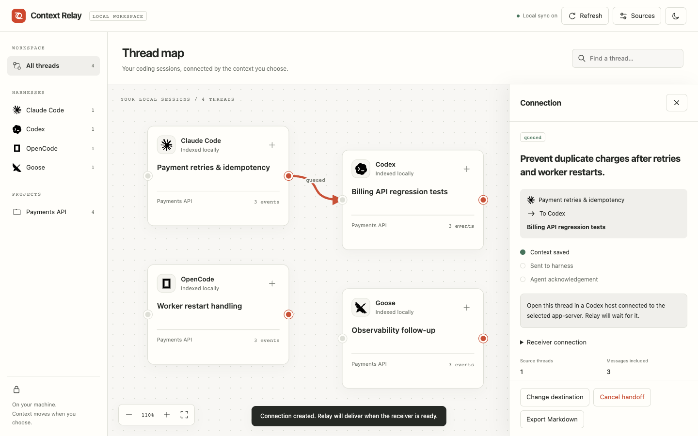
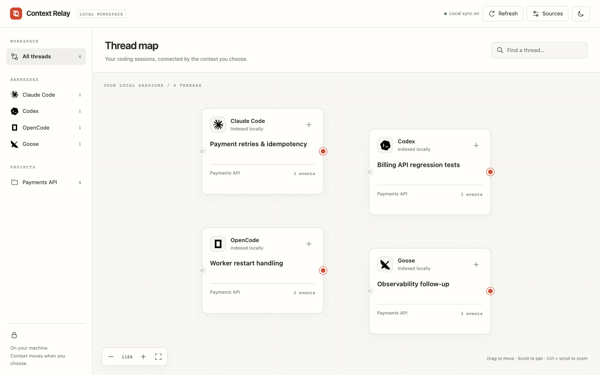
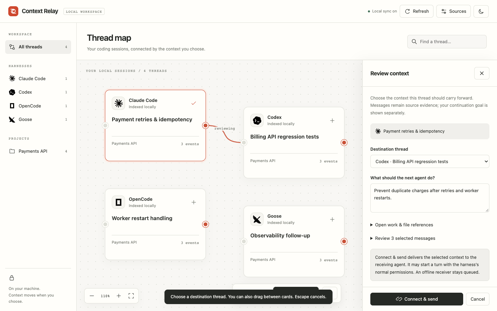
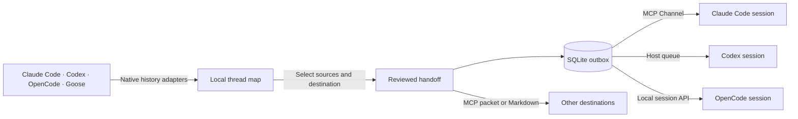

# Context Relay

**Keep the work. Change the thread.** Discover local coding sessions, connect them on a canvas, review what moves, and deliver an addressed handoff.



*The current `0.4.0-dev.0` dashboard, captured with synthetic sessions. The public npm beta is still `0.3.0-beta.1`.*

<p align="center">
  <a href="https://github.com/mahekara28/context-relay/actions/workflows/npm.yml"></a>
  <a href="https://github.com/mahekara28/context-relay/blob/main/package.json"></a>
  <a href="https://www.npmjs.com/package/@mahekara28/context-relay"></a>
  <a href="https://github.com/mahekara28/context-relay/blob/main/LICENSE"></a>
</p>

<p align="center"><strong>Your next coding session should inherit the decisions, not the confusion.</strong></p>

<p align="center">
  <a href="https://mahekara28.github.io/context-relay/">Website &amp; interactive tour</a> · <a href="https://www.npmjs.com/package/@mahekara28/context-relay">npm package</a> · <a href="https://github.com/mahekara28/context-relay/releases/tag/npm-v0.3.0-beta.1">Release notes</a> · <a href="#why-context-relay">Why Relay</a> · <a href="#try-it-locally">Install</a> · <a href="#the-workflow">Workflow</a> · <a href="#where-mcp-fits">Architecture</a> · <a href="#what-is-verified">Verification</a>
</p>

## Development preview: local thread map

This checkout is `0.4.0-dev.0`. The new default UI automatically discovers local harness sessions, displays them as movable thread cards, and lets you drag connections to review and relay context. It includes background capture, magnetic drag-to-connect, targeted handoffs, a persistent delivery queue, and receiving integrations for Claude MCP Channels, reachable Codex hosts, and OpenCode. See the receiver requirements below; native desktop attachment varies by harness. **This revamp is not yet published to npm; the public beta below remains `0.3.0-beta.1`.**

```sh
npm ci
npm run build
node dist/cli.js ui --data-dir /absolute/path/to/relay-map-profile
```



*Development UI captured from isolated synthetic sessions.*

[Thread map interaction, architecture, limits, and local setup](docs/THREAD_MAP.md). Opening the map enables local background discovery; pause it in Sources or stop the local service with `relay stop`. Handoffs require review and acknowledgement from the receiving agent.

## Why Context Relay?

You've spent hours in a coding thread. Requirements changed. A tool failed. The agent tried three approaches. The context keeps growing, and starting a fresh thread means explaining everything again.

**Context Relay turns that history into a reviewed handoff.** Find a session, select its evidence, capture the current instructions and open work, then continue in a fresh thread—even in another harness.

- **See the history.** Browse captured threads from Claude Code, Codex, OpenCode and Goose, with visible source events and character growth.
- **Keep the corrections.** Review instructions beside the evidence they cite. Merge checkpoints with explicit conflict choices.
- **Continue with a receipt.** Offer an immutable packet to a destination agent through MCP, or export readable Markdown. Check source revisions, recorded files and Git HEAD before acceptance.



*The review drawer keeps the source, destination, goal and included messages visible before delivery. [Reproduce these synthetic captures](scripts/npm/render-map.mjs).*

## Try it locally

**Node 22.16+ · npm · no Python or model API key required**

Install the public beta from [npm](https://www.npmjs.com/package/@mahekara28/context-relay):

```sh
npm install --global @mahekara28/context-relay@beta
relay demo
relay ui
```

Or try it with **npx**, without a global installation:

```sh
npx @mahekara28/context-relay@beta demo
npx @mahekara28/context-relay@beta ui
```

Use `@0.3.0-beta.1` instead of `@beta` to pin this release. Both methods use the same local workspace. The package is a beta; live model-quality evaluation remains pending.

The package includes the compiled CLI, local service, MCP server, SQLite store and UI assets. After installation, Relay needs no frontend build step or CDN. `relay demo` creates explicitly synthetic sessions in its own demo project. `relay stop` stops the local service.

Use `--data-dir /path/to/workspace` on any command for a separate profile. The default is `~/.context-relay`. [Installation and CLI reference](https://github.com/mahekara28/context-relay/blob/main/docs/NPM_QUICKSTART.md)

## Published beta workflow

| Step | What happens |
| --- | --- |
| **1. Connect** | Register a project and connect a harness. Relay can add a project MCP entry while preserving unrelated settings. |
| **2. Capture** | Discover matching sessions and choose what to import. Background jobs expose progress, failures and cancellation. |
| **3. Review** | Select source events. Write the current goal, cited instructions, acceptance criteria and open work. Optionally generate a draft with Nebius. |
| **4. Merge** | Combine existing checkpoints into a new snapshot. Resolve conflicting instruction keys explicitly. |
| **5. Continue** | Offer the packet to a harness. Open a fresh session, inspect the handoff and accept it through MCP; or use a Markdown export. |

```sh
relay project add --root /absolute/path/to/project
relay connect --project PROJECT_ID --harness claude
relay discover --id CONNECTION_ID
relay sync --id CONNECTION_ID
relay ui
```

For a configured Claude Code or Codex destination, `relay launch --id HANDOFF_ID` opens a fresh interactive session with the continuation prompt and the harness's normal approvals. OpenCode and Goose use the copied prompt or export. Relay never writes into native chat databases.

## Where MCP fits



The UI renders indexed sessions and their handoffs. Native adapters read local history; MCP exposes reviewed packets and, when a Claude receiver is bound, can push a channel notification. Codex direct delivery requires a reachable existing host; OpenCode uses the same local server as capture. Goose capture is available, with MCP or Markdown for continuation.

**Capture and MCP solve different parts of the workflow.** Installing MCP alone does not make a harness's conversation history available.

| Harness | Native capture | Receiving the new handoff |
| --- | --- | --- |
| Claude Code | Project-filtered JSONL | Session-bound MCP Channel after one-time receiver setup |
| Codex | App-server completed turns | Native queue on a reachable host that owns the destination thread |
| OpenCode | Loopback session/messages API | Addressed prompt on the same running local server |
| Goose | CLI JSON list/export | MCP retrieval or Markdown fallback; no direct dispatch |

All four have implemented capture adapters. Native format coverage and limits are explicit in the [connection guide](https://github.com/mahekara28/context-relay/blob/main/docs/HARNESS_CONNECTIONS.md); they are not a claim that every harness version has been live-certified.

### Optional Nebius Token Factory

Manual checkpoints work without a key. To request model-assisted drafts, set `NEBIUS_API_KEY` and `NEBIUS_MODEL` in the service environment and restart Relay. The UI previews the exact selected, redacted evidence before sending it. Responses must pass schema and citation validation, then return to the editor for review.

No automatic summarization loop, hidden provider fallback or model-written authoritative state. [Provider setup and data flow](https://github.com/mahekara28/context-relay/blob/main/docs/WORKSPACE.md#nebius-proposals)

## What is verified

- **Node tests:** transactional imports, provenance, explicit merge conflicts, packet budgets, stale source/file rejection, recipient checks, adapters, provider validation and launch planning.
- **Real transports:** an MCP stdio client, a JSON-RPC subprocess, a loopback HTTP capture source and an isolated installed Codex app-server initialization/listing check.
- **Chromium workflows:** source review, handoff and export, conflict resolution, mobile/dark navigation and unauthenticated entry.
- **Public npm release:** publisher and tarball integrity verified, with fresh anonymous global and npx installs, demo/UI, context packet and handoff checks. [Release artifact and verification report](https://github.com/mahekara28/context-relay/releases/tag/npm-v0.3.0-beta.1).
- **Installed package gates:** anonymous global and npm exec/npx tarball installation, CLI/service lifecycle, bundled UI assets, authentication and restart persistence on Linux, macOS and Windows CI.

The model quality benchmark remains pending: no live Nebius completion or cross-harness coding result is claimed. Acceptance proves delivery, not successful task completion. [Detailed verification and release boundaries](https://github.com/mahekara28/context-relay/blob/main/docs/releases/NPM_VERIFICATION.md)

## Local by default

Relay binds to `127.0.0.1`, authenticates API requests and rejects foreign origins and host headers. The browser token is passed in a URL fragment, removed immediately and retained in the current tab's session storage. Drafts stay in memory until saved. Files are referenced by path and digest; they are not transferred.

In the published beta, capture and discovery are explicit. In the development map, authenticated first opening enables background discovery from known harness sources; source selection and pause controls are available in Sources. Recognized credentials are redacted before persistence, but this is best effort: inspect sensitive material before sharing it. Nebius receives only evidence you explicitly select and approve. [Workspace operations](https://github.com/mahekara28/context-relay/blob/main/docs/WORKSPACE.md)

## Develop and contribute

```sh
npm ci
npm run typecheck
npm test
npm run test:package
npx playwright install chromium
npm run test:browser
```

The TypeScript product lives in [`packages/relay`](https://github.com/mahekara28/context-relay/blob/main/packages/relay). The existing Python research/API implementation remains available with its own database and versioning; see the [Python reference](https://github.com/mahekara28/context-relay/blob/main/README.python.md). No automatic migration or shared writable database is implied.

See the [release series](https://github.com/mahekara28/context-relay/blob/main/docs/releases/NPM_RELEASE_PLAN.md), [contribution guide](https://github.com/mahekara28/context-relay/blob/main/CONTRIBUTING.md) and [license](https://github.com/mahekara28/context-relay/blob/main/LICENSE). Harness logos are bundled from the MIT-licensed Lobe Icons package with [attribution](https://github.com/mahekara28/context-relay/blob/main/packages/relay/ui/assets/THIRD_PARTY_LICENSE.txt); product names identify integrations and do not imply endorsement.
