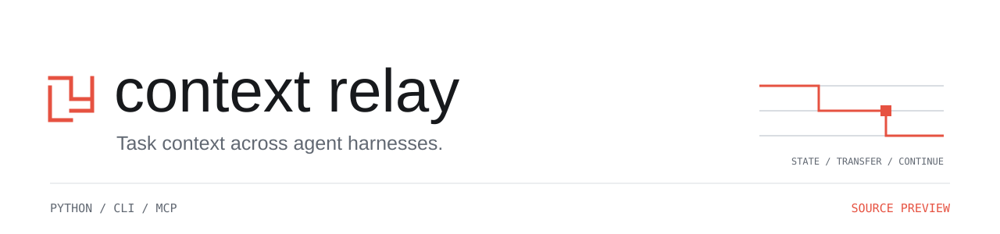
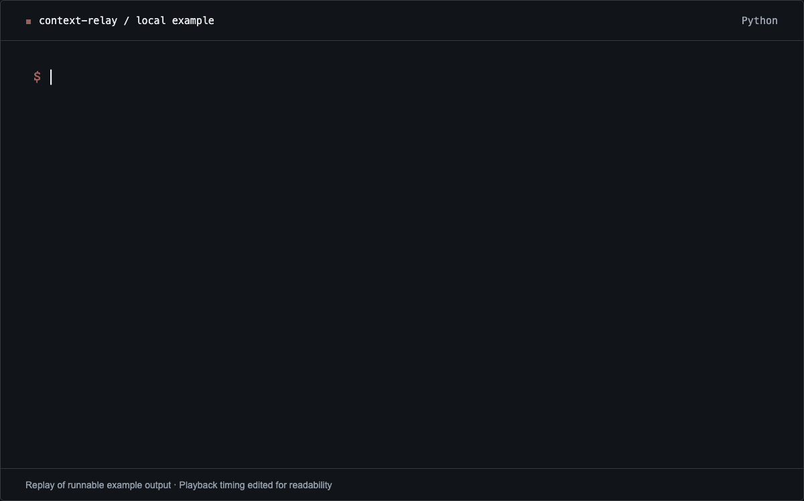
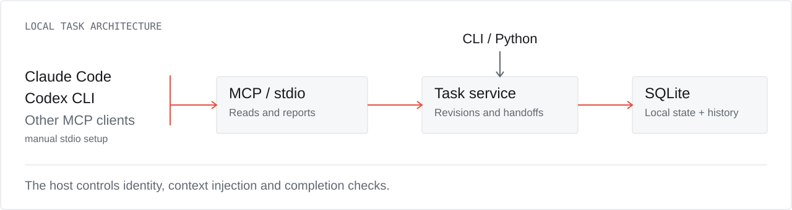

<picture>
  <source media="(prefers-color-scheme: dark) and (max-width: 600px)" srcset="docs/assets/banner-dark-mobile.svg" />
  <source media="(prefers-color-scheme: dark)" srcset="docs/assets/banner-dark.svg" />
  <source media="(max-width: 600px)" srcset="docs/assets/banner-light-mobile.svg" />
  
</picture>

<p align="center">
  <a href="https://github.com/mahekara28/context-relay/actions/workflows/alpha.yml"></a>
  <a href="docs/TASK_QUICKSTART.md"></a>
  <a href="pyproject.toml"></a>
  <a href="LICENSE"></a>
</p>

<p align="center"><strong>Pick up the task with its current instructions, sources and open work.</strong></p>

<picture>
  <source media="(prefers-reduced-motion: reduce) and (max-width: 600px)" srcset="docs/assets/demo-mobile.png" />
  <source media="(prefers-reduced-motion: reduce)" srcset="docs/assets/demo.png" />
  <source media="(max-width: 600px)" srcset="docs/assets/demo-mobile.gif" />
  
</picture>

<p align="center"><sub>Output from the runnable local example; playback timing edited for readability.<br />
<a href="examples/task_handoff_demo.py">Run it yourself</a> · <a href="docs/assets/demo-transcript.txt">Text transcript</a> · <a href="docs/assets/demo.png">Still image</a></sub></p>

<p align="center">
  <a href="#quick-start">Quick start</a> ·
  <a href="#connect-an-agent">Connect an agent</a> ·
  <a href="#how-it-works">Architecture</a> ·
  <a href="#evidence">Evidence</a> ·
  <a href="#roadmap">Roadmap</a>
</p>

<picture>
  <source media="(prefers-color-scheme: dark) and (max-width: 600px)" srcset="docs/assets/capabilities-dark-mobile.svg" />
  <source media="(prefers-color-scheme: dark)" srcset="docs/assets/capabilities-dark.svg" />
  <source media="(max-width: 600px)" srcset="docs/assets/capabilities-light-mobile.svg" />
  
</picture>

## Why Relay

An agent starts a report. You change the output from CSV to JSON. Another agent
picks up the work later. Which instruction is current? Where did it come from?
What still needs doing?

Context Relay stores those answers as a **versioned task packet** in local SQLite:

- **Current instructions with history.** Explicitly replace an instruction while
  keeping the old version and its source available for inspection.
- **Handoffs with checks.** Freeze a revision, name its recipient, and check packet
  integrity and revision freshness when the recipient accepts it.
- **Completion backed by evidence.** Host-run checks bind verification to artifact
  state. An accepted handoff or a model's report alone does not prove completion.

> **Source preview.** The task API is experimental. Install from this checkout;
> the bundled v0.22.0a3 wheel predates it. Live model handoff evaluation is pending.

<a id="install"></a>

## Quick start

**Python 3.10+** · No model API key · No core runtime dependencies

```sh
git clone https://github.com/mahekara28/context-relay.git
cd context-relay
python -m venv .venv
source .venv/bin/activate
python -m pip install .
python examples/task_handoff_demo.py
```

On Windows PowerShell, activate with `.venv\Scripts\Activate.ps1`.
Source installation may download build tools; this alpha is not published on PyPI.

The example creates a temporary database, replaces `Use CSV` with `Use JSON`,
and accepts a handoff as the named receiver. It checks the resulting state before
printing it, then removes the database. Add `--json` to inspect the selected result
fields. It does not call a model or implement the report.

For a persistent task and the equivalent CLI commands, follow the
[task quickstart](docs/TASK_QUICKSTART.md).

<a id="integrations"></a>
<a id="connect-to-your-agent"></a>

## Connect an agent

Use **Python 3.11+** for the optional MCP server. Choose the project configuration
generator for your harness:

```sh
python -m pip install '.[mcp]'

context-relay connector claude configure --root .
# Or:
context-relay connector codex configure --root .
```

| Entry point | Included today |
| --- | --- |
| **Claude Code** | Project MCP configuration generator and diagnostics |
| **Codex CLI** | Project MCP configuration generator and diagnostics |
| **Other MCP clients** | Stdio server; configure and check compatibility manually |
| **CLI / Python** | Direct access to task state, packets, handoffs and diagnostics |

Reload your harness, then invoke the MCP tools explicitly. Diagnose the generated
configuration with `context-relay connector claude diagnose --root .` (or `codex`).
These are configuration integrations; a live Claude-to-Codex model evaluation is
still needed. See [MCP setup](docs/MCP_TASK_SERVER.md).

## How it works

<picture>
  <source media="(prefers-color-scheme: dark) and (max-width: 600px)" srcset="docs/assets/architecture-dark-mobile.svg" />
  <source media="(prefers-color-scheme: dark)" srcset="docs/assets/architecture-dark.svg" />
  <source media="(max-width: 600px)" srcset="docs/assets/architecture-light-mobile.svg" />
  
</picture>

The eight MCP tools expose health, task inspection, packets, diffs, reports and
handoff inspection/acceptance. Authoritative instruction changes and handoff
offers use the CLI or Python API. The host supplies identity and policy, decides
when to inject context, and runs completion checks.

A packet carries the goal and criteria, active instructions and sources, Git
workspace identity, artifact references, evidence and open work. It has a
**character budget**: required state must fit; omitted optional entries are counted.
Artifact references do not transfer file bytes. The receiver checks their availability
and recorded state.

<details>
<summary><strong>Inspect the example's packet fields</strong></summary>

Selected fields from the [checked example output](docs/assets/demo-output.json);
IDs, timestamps and workspace paths are omitted here.

```json
{
  "revision": 2,
  "goal": "Produce a regional revenue report",
  "instructions": [
    {"text": "Use JSON", "source": {"kind": "user", "ref": "message-2"}}
  ],
  "open_work": ["Implement JSON export", "Run the report oracle"]
}
```

The full contract is in the [JSON Schema](schemas/task-context-v1alpha1.schema.json).
See the [design](docs/TASK_CONTEXT_ADR.md) and [packet compiler](src/context_relay/task_packet.py).

</details>

<details>
<summary><strong>Using the earlier Python memory API?</strong></summary>

The existing session and provider APIs remain available:

```python
from context_relay import auto_connect

with auto_connect(existing_client, conversation="report-42") as ai:
    response = ai(messages=full_history, model=your_model)
```

Pass your actual client, model and full original message history; append messages
without rewriting previous ones. Async clients use `async with` and `await`.
Calls through the original client bypass Relay. Anthropic also requires
`max_tokens`. Reuse the conversation name and storage location across restarts.

Paths include Python callables, Ollama, OpenAI, Anthropic and an optional
LangChain/LangGraph bridge. See [connection options](docs/AUTO_CONNECT.md),
[named memory](docs/NAMED_MEMORY.md), [provider support and recovery](docs/RESPONSES_WORKFLOW.md),
and [instruction clarification](docs/INSTRUCTION_CLARIFICATION.md).

Run `python -m context_relay quickstart` for the offline memory check supported
by the bundled wheel. See [distribution notes](PUBLIC_DISTRIBUTION.md) and
[Verified Release Desk](examples/verified_release_desk.py) with its
[setup guide](docs/PROTECTION_PROFILE.md).

</details>

<a id="what-has-been-tested"></a>

## Evidence

| Check | What it establishes |
| --- | --- |
| [Core CI: Linux and Windows](https://github.com/mahekara28/context-relay/actions/workflows/alpha.yml) | Regression coverage, installed-package checks and offline examples |
| [MCP adapter tests](tests/test_mcp_adapter.py) | Two-client task handoffs and a real stdio subprocess client |
| [Concurrency](tests/test_task_concurrency.py) / [restart recovery](tests/test_task_effect_restart.py) | Conflicting revisions and interrupted file effects under the covered conditions |
| [Continuation fixture](evaluations/continuation/README.md) | A disclosed stale CSV implementation fails an independent JSON report oracle |

These checks do not establish a model quality improvement. A live cross-harness
run and a matched Markdown baseline remain open. Earlier memory evaluation
results and limits are in the [validation report](docs/VALIDATION.md).

## Limits and trust

- **Local storage.** SQLite state is plaintext. Keep it private to your OS user.
  A subject label is not remote authentication; distributed reliability is unproven.
- **Host responsibility.** MCP registration does not capture sessions automatically.
  Reports retain their provenance; verification depends on the supplied checks
  and sources. Receipts cannot undo external writes, and interrupted effects need
  destination evidence to resolve their outcome.
- **Explicit instruction updates.** The legacy parser recognised only 1 of 11
  clear changes in a separate wording test. Broad natural-language interpretation
  remains future work.

[Storage and privacy](docs/STORAGE_PRIVACY.md) ·
[Task trust model](docs/TASK_CONTEXT_ADR.md#trust-and-scope) ·
[Recovery](docs/RESPONSES_WORKFLOW.md#results-and-recovery)

## Roadmap

- [x] Versioned task state, sourced updates and immutable handoff offers
- [x] Local MCP server, project configuration generators and host verification APIs
- [ ] Publish a reproducible task finished across two coding harnesses
- [ ] Compare it with a matched Markdown handoff and independent completion oracle
- [ ] Evaluate optional Nebius-assisted interpretation and additional harness adapters

See the [design direction](docs/TASK_CONTEXT_ADR.md) and
[evaluation fixture](evaluations/continuation/README.md). Remote collaboration
comes after local validation.

## Contributing

Bring a failing handoff, missed instruction, stale artifact or reproducible harness
integration. [Open an issue](https://github.com/mahekara28/context-relay/issues)
with expected behavior, actual behavior and synthetic input.

```sh
python -m pip install -e .
python -m unittest discover -s tests -v
```

Add regression coverage for behavior changes. Optional SDK tests may skip;
see [validation dependencies](requirements-validation.txt). Install `'.[mcp]'`
for the MCP tests. The [artwork and replay](docs/assets/README.md) are reproducible
from source.

---

[MIT license](LICENSE) · [Task quickstart](docs/TASK_QUICKSTART.md) · [Design notes](docs/TASK_CONTEXT_ADR.md)
