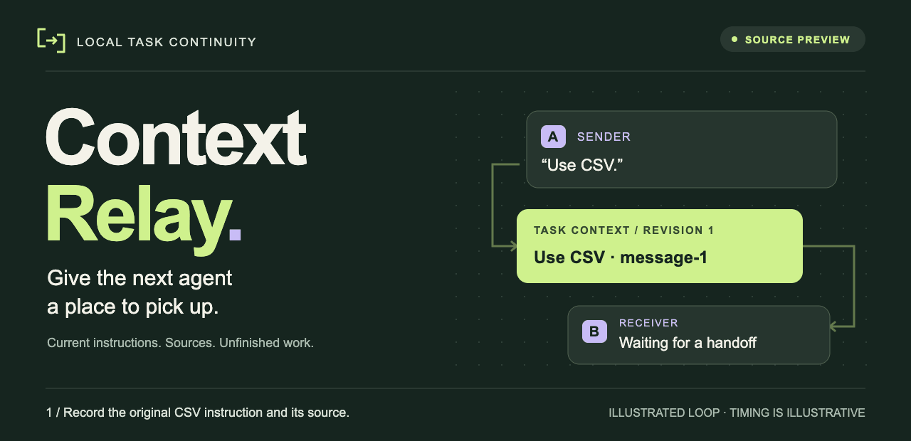
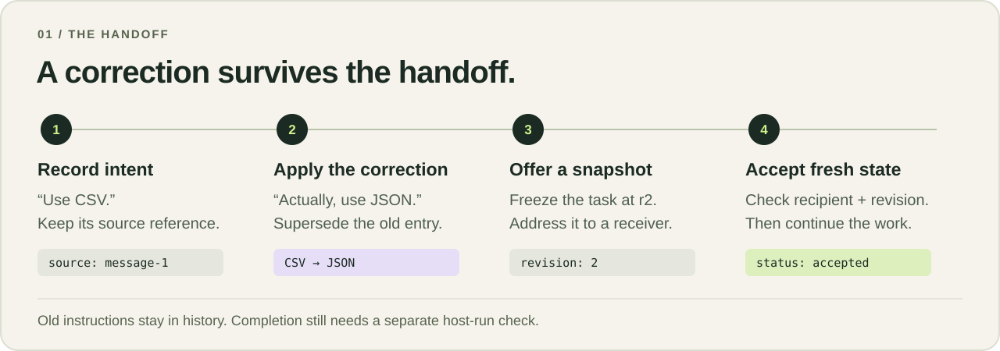
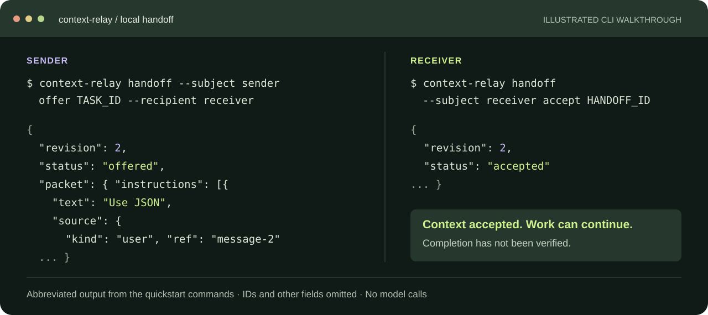
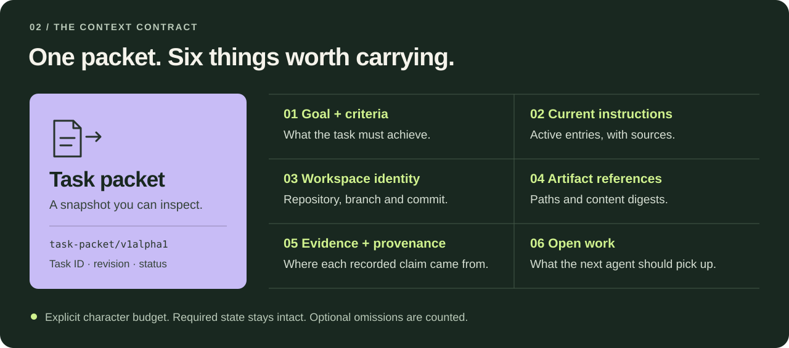
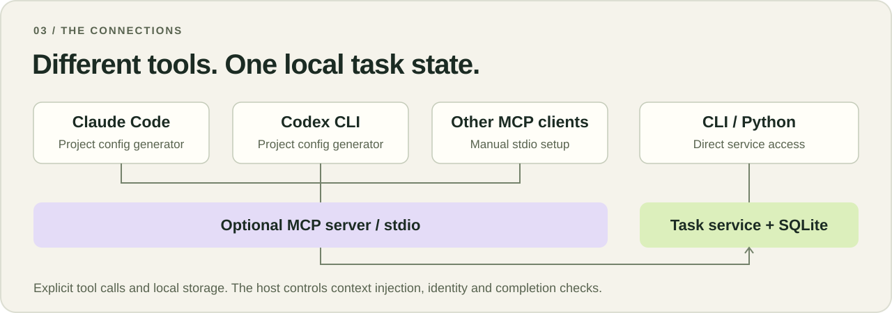

<p align="center">
  <picture>
    <source media="(prefers-reduced-motion: reduce) and (max-width: 600px)" srcset="docs/assets/relay-hero-mobile.svg" />
    <source media="(prefers-reduced-motion: reduce)" srcset="docs/assets/relay-hero.svg" />
    <source media="(max-width: 600px)" srcset="docs/assets/relay-hero-mobile.gif" />
    
  </picture>
</p>

<p align="center"><sub>Illustrated handoff · <a href="docs/assets/relay-hero.svg">View still image</a></sub></p>

<h1 align="center">Context Relay</h1>

<p align="center">
  <strong>Carry the current state of unfinished work between agent harnesses.</strong><br />
  Goals, revised instructions, source evidence and open work — in one inspectable task packet.
</p>

<p align="center">
  <a href="https://github.com/mahekara28/context-relay/actions/workflows/alpha.yml"></a>
  <a href="docs/TASK_QUICKSTART.md"></a>
  <a href="pyproject.toml"></a>
  <a href="docs/MCP_TASK_SERVER.md"></a>
  <a href="LICENSE"></a>
</p>

<p align="center">
  <a href="#quick-start">Quick start</a> ·
  <a href="#how-it-works">How it works</a> ·
  <a href="#integrations">Connect an agent</a> ·
  <a href="#what-has-been-tested">Evidence</a> ·
  <a href="#roadmap">Roadmap</a> ·
  <a href="#contributing">Contribute</a>
</p>

An agent starts a report. You change the output from CSV to JSON. Another agent
picks up the work later and needs the **current instruction, its source, the
workspace state and what remains to be done**. Context Relay stores those pieces
explicitly and offers them to the next harness as a versioned snapshot.

**The task handoff API is an experimental source preview.** The bundled
v0.22.0a3 wheel covers the earlier Python memory API; install from source for the
features shown here. Live model handoff evaluation is still pending.

## How it works

<picture>
  <source media="(max-width: 600px)" srcset="docs/assets/relay-handoff-mobile.svg" />
  
</picture>

- **Keep the current instruction.** Explicit supersession preserves the old
  instruction in history and puts the active one in the next packet.
- **Make the handoff inspectable.** Each offer freezes a task revision.
  Acceptance checks the named recipient, packet integrity and revision freshness.
- **Verify the actual result.** Host-run criterion checks bind verification to
  artifact state. Changed sources or artifacts can invalidate it.

The host decides which sources to trust, when to inject context and how to check
completion. Registering an MCP server gives an agent explicit tools; it does not
automatically capture sessions or verify the agent's work.

<a id="install"></a>

## Quick start

Use **Python 3.10+** for the core CLI, or **Python 3.11+** for the optional MCP server.
From a terminal, create an environment and install the source checkout:

```sh
git clone https://github.com/mahekara28/context-relay.git
cd context-relay
python -m venv .venv
source .venv/bin/activate
python -m pip install .
python -m context_relay task --db .relay/tasks.db doctor
```

On Windows PowerShell, activate with `.venv\Scripts\Activate.ps1` and enter the
multiline examples on one line.
The core has no runtime dependencies and needs no model API key. Source
installation may download build tools. This alpha is not published on PyPI.

Create a task bound to this Git worktree:

```sh
context-relay task create \
  --goal 'Produce a JSON net-revenue report by region' \
  --criterion 'The independent report oracle passes' --root .
```

Copy the returned `id` as `TASK_ID`. The task starts at revision `0`.
All commands below use the default local database, `.relay/tasks.db`.

<details>
<summary><strong>Try the full CSV → JSON handoff</strong></summary>

Record the original instruction. Copy its returned instruction `id` as
`OLD_INSTRUCTION_ID`:

```sh
context-relay task instruct TASK_ID \
  --expected-revision 0 --request-id instruction-csv \
  --text 'Use CSV' --source-kind user --source-ref message-1
```

Explicitly replace that instruction with the user's correction:

```sh
context-relay task instruct TASK_ID \
  --expected-revision 1 --request-id instruction-json \
  --text 'Use JSON' --source-kind user --source-ref message-2 \
  --supersedes OLD_INSTRUCTION_ID
```

Offer revision `2` to a named receiver, then copy the returned offer `id` as
`HANDOFF_ID` and accept it:

```sh
context-relay handoff --subject sender offer TASK_ID --recipient receiver
context-relay handoff --subject receiver accept HANDOFF_ID
context-relay task diagnose TASK_ID
```

The accepted packet contains `Use JSON` and source `message-2`. The earlier CSV
instruction remains in task history. Acceptance records the handoff; it does
not mark the reporting task complete. `--subject` is a local harness label,
not authentication. Keep the database private to your OS user.

</details>

<picture>
  <source media="(max-width: 600px)" srcset="docs/assets/relay-cli-mobile.svg" />
  
</picture>

The illustration abbreviates the commands' output and omits IDs and other
fields. Reproduce it with the steps above or the [complete task quickstart](docs/TASK_QUICKSTART.md).

## Inside the packet

<picture>
  <source media="(max-width: 600px)" srcset="docs/assets/relay-packet-mobile.svg" />
  
</picture>

Packets have an explicit **character budget**. Required state must fit; optional
artifact and evidence entries may be omitted, with omission counts included.
Artifact references do not transfer file bytes. The receiver must check that
referenced files are available and still match their recorded state.

Read the [task contract design](docs/TASK_CONTEXT_ADR.md),
[JSON Schema](schemas/task-context-v1alpha1.schema.json) and
[packet compiler](src/context_relay/task_packet.py).

## Integrations

<picture>
  <source media="(max-width: 600px)" srcset="docs/assets/relay-integrations-mobile.svg" />
  
</picture>

Install the MCP extra using Python 3.11+, then configure the harness you use:

```sh
python -m pip install '.[mcp]'

# Choose either or both in this project.
context-relay connector claude configure --root .
context-relay connector codex configure --root .
```

These generators edit project-local configuration. Restart or reload your
harness as needed, then use its MCP tools explicitly. Check an entry with
`context-relay connector claude diagnose --root .` or the equivalent `codex`
command. See [MCP setup and trust boundaries](docs/MCP_TASK_SERVER.md).

| Entry point | Available today | What still needs your host |
| --- | --- | --- |
| **Claude Code** | Project MCP configuration generator and diagnostics | Context injection, tool use and completion checks; live model handoff evaluation is pending. |
| **Codex CLI** | Project MCP configuration generator and diagnostics | The same host responsibilities; live model handoff evaluation is pending. |
| **Other MCP clients** | Optional stdio server for manual configuration | Client configuration and a compatibility check for your harness. |
| **CLI / Python** | Direct task storage, packets, handoffs and diagnostics | Identity and policy; host-run verification and file effects use explicit Python APIs. |

<a id="connect-to-your-agent"></a>

<details>
<summary><strong>Already using Relay's Python memory API?</strong></summary>

The existing session and provider APIs remain available:

```python
from context_relay import auto_connect

with auto_connect(existing_client, conversation="report-42") as ai:
    response = ai(messages=full_history, model=your_model)
```

Pass your actual client, model and full original message history; append new
messages without rewriting previous ones. Async clients use `async with` and
`await`. Calls through the original client bypass Relay. Anthropic also requires
`max_tokens`. Reuse the conversation name and storage location across restarts.

Supported paths include plain Python callables, Ollama, OpenAI, Anthropic and an
optional LangChain/LangGraph bridge. Native modes and streaming have limitations;
see [connection options](docs/AUTO_CONNECT.md), [named memory](docs/NAMED_MEMORY.md)
and [provider workflow support](docs/RESPONSES_WORKFLOW.md). Handle disputed
preferences through [instruction clarification](docs/INSTRUCTION_CLARIFICATION.md).

Run `python -m context_relay quickstart` for the original offline memory check.
The bundled wheel supports that check, but predates the task preview.
The [distribution notes](PUBLIC_DISTRIBUTION.md) explain the release artifacts.
For registered tool checks and result verification, try
[Verified Release Desk](examples/verified_release_desk.py) and its
[setup guide](docs/PROTECTION_PROFILE.md).

</details>

## What has been tested

| Evidence | What it establishes |
| --- | --- |
| [Core CI on Linux and Windows](https://github.com/mahekara28/context-relay/actions/workflows/alpha.yml) | Automated regression coverage, installed-package checks and offline examples. |
| [MCP adapter tests](tests/test_mcp_adapter.py) | Two-client task handoffs and a real stdio subprocess client. |
| [Concurrent writes](tests/test_task_concurrency.py) and [restart recovery](tests/test_task_effect_restart.py) | Conflicting revisions and interrupted file effects under the covered test conditions. |
| [Coding continuation fixture](evaluations/continuation/README.md) | A disclosed stale CSV implementation fails the independent JSON report oracle. |

These checks do not establish a model quality improvement. A live
Claude-to-Codex run and a matched Markdown handoff baseline are still needed.
Earlier memory evaluations also do not establish a cross-harness improvement;
the [validation report](docs/VALIDATION.md) records their findings and limits.

## Limits and trust

- **Local, experimental storage.** State lives in plaintext SQLite. Keep it
  private to the OS user. The local subject label is not remote authentication;
  shared or distributed deployment reliability has not been established.
- **Explicit host integration.** The host supplies identity and policy, injects
  context and runs completion checks. Model reports retain their provenance and
  do not become verified outcomes by themselves.
- **Verification depends on your checks.** A wrong oracle or source can still
  produce a wrong result. A receipt cannot undo an external write. Interrupted
  effects need destination evidence before their outcome is resolved.
- **Instruction extraction has limits.** The legacy parser recognised only
  1 of 11 clear changes in a separate wording test. The task API uses explicit
  sourced updates; broad natural-language interpretation remains future work.

[Storage and privacy](docs/STORAGE_PRIVACY.md) ·
[Task trust model](docs/TASK_CONTEXT_ADR.md#trust-and-scope) ·
[Recovery](docs/RESPONSES_WORKFLOW.md#results-and-recovery)

## Roadmap

| Available in the source preview | Next evidence to build | Later exploration |
| --- | --- | --- |
| Versioned task state and sourced instruction changes | A live handoff between two coding harnesses | Optional Nebius model-assisted interpretation |
| Immutable offers, explicit acceptance and local MCP | A matched Markdown baseline using the same task and receiver | Additional harness adapters, measured individually |
| Artifact checks, host verification and file-effect reconciliation | Broader tasks and independent completion oracles | Remote collaboration after local validation |

The next milestone is a reproducible task finished across two harnesses, with
its artifact and test results published. See the
[design direction](docs/TASK_CONTEXT_ADR.md) and [evaluation fixture](evaluations/continuation/README.md).

## Contributing

Useful contributions include a minimal failing handoff, a missed instruction,
a stale artifact case or a reproducible harness integration. [Open an issue](https://github.com/mahekara28/context-relay/issues)
with expected behavior, actual behavior and synthetic input.

```sh
python -m pip install -e .
python -m unittest discover -s tests -v
```

Optional SDK tests may skip without their dependencies; see
[validation requirements](requirements-validation.txt). Add regression coverage
for behavior changes. For the optional MCP tests, install `'.[mcp]'` first.
The [README artwork](docs/assets/README.md) is editable SVG with separate mobile layouts.

<p align="center">
  <strong>Keep the task moving.</strong><br />
  <a href="docs/TASK_QUICKSTART.md">Try a local handoff</a> ·
  <a href="docs/TASK_CONTEXT_ADR.md">Read the design</a> ·
  <a href="https://github.com/mahekara28/context-relay/issues">Bring a failure case</a>
</p>

<p align="center">Built in the open · <a href="LICENSE">MIT license</a></p>
