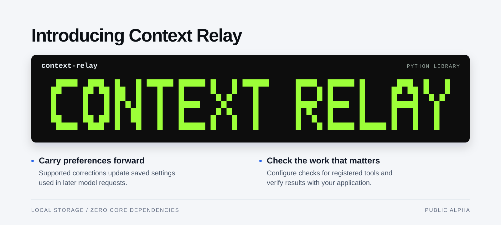
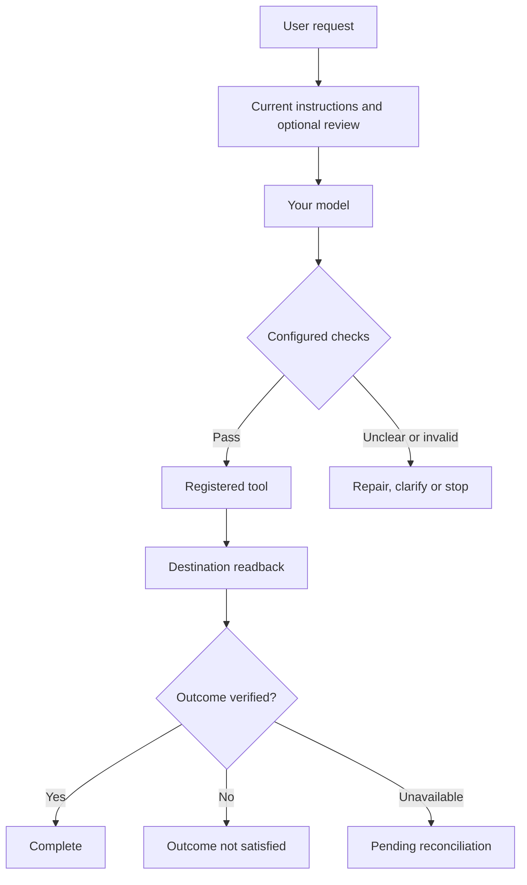

<div align="center">

# Context Relay

### Current instructions. Checked actions.

A local Python library that carries current preferences into model requests and checks configured tool actions.

[](https://github.com/mahekara28/context-relay/actions/workflows/alpha.yml)
[](docs/ALPHA.md)
[](pyproject.toml)
[](pyproject.toml)
[](LICENSE)

[Install](#install) · [Quick start](#quick-start) · [How it works](#how-it-works) · [Integrations](#integrations) · [Validation](#what-has-been-tested) · [Limits](#limits-and-trust) · [Roadmap](#roadmap)

</div>



> [!IMPORTANT]
> **Public alpha · v0.21.0a1.** Basic memory connects through a supported client.
> Action checks and outcome verification require configuration. Correction
> recognition remains limited; see the [current limits](#limits-and-trust).

## The problem, in one example

Long conversations can leave an agent acting on an old instruction. For example,
you ask for a CSV report, then change your mind:

> “Actually, use JSON instead of CSV.”

Later, the agent proposes CSV again. Relay gives your application several ways
to handle this while keeping its existing model, tools and UI:

| With Relay configured | What happens |
| --- | --- |
| **Basic memory** | A supported correction updates the saved preference to JSON. Later model requests include that current value. |
| **Tool protection** | A registered export tool checks its proposed format against the active preference before writing. |
| **Known-value repair** | If the configured rule supplies a valid replacement, Relay can correct the proposal and check it again before execution. |
| **Outcome verification** | Your application's verifier reads the destination to check that the expected result actually exists. |

These are separate controls. Adding memory alone does not enable the other three.
For critical preferences, an optional review gate asks for an explicit decision
on every new user turn, before inference or action.

## Install

You need **Python 3.10+**. In your Python environment, clone the repository and
install the bundled alpha wheel:

```sh
git clone https://github.com/mahekara28/context-relay.git
cd context-relay
python -m pip install --no-index --no-deps dist/context_relay_local-0.21.0a1-py3-none-any.whl
python -m context_relay quickstart
```

The check prints:

```text
Offline connection check: PASSED
Preference received by the local stand-in: CSV -> JSON
No AI, SDK or network calls. This checks memory wiring, not model quality.
Next: use auto_connect(existing_client) once per conversation and send messages through it.
```

After cloning, installation and this check work offline. No API key, hosting or
model download is needed. The core has no runtime dependencies; your chosen
provider keeps its usual costs. **This alpha is not published on PyPI.**

<details>
<summary>Install from source or try the optional local UI</summary>

From the cloned repository:

```sh
python -m pip install .
python -m context_relay quickstart
```

Source installation may download Python build tools. The bundled wheel avoids
that download. To open the optional inspection UI:

```sh
python run.py serve
```

Visit `http://127.0.0.1:8765`. The UI is a local demonstration; your application
does not need it to use the library.

</details>

<a id="connect-to-your-agent"></a>

## Quick start

Wrap the client your project already uses and send calls through the returned connection:

```python
from context_relay import auto_connect

with auto_connect(existing_client, conversation="customer-42") as ai:
    response = ai(messages=full_history, model=your_model)
    # Keep using this connection for this conversation's later calls.
```

`existing_client`, `full_history` and `your_model` are your application's existing
values. Keep your usual provider options; Anthropic also needs `max_tokens`.
Async clients use `async with` and `await ai(...)`.

Use one connection per conversation and pass the **full original, append-only
history** each time. The conversation name saves memory locally; reuse that name
and storage location after a restart. Omit the name for temporary memory.
Closing Relay leaves your provider client open. Direct calls through the original
client bypass Relay.

For completed text replies, `ai.conversation()` can manage history for you.
[Connection guide](docs/AUTO_CONNECT.md) · [Clarification handling](docs/INSTRUCTION_CLARIFICATION.md) · [Persistent memory](docs/NAMED_MEMORY.md)

<details>
<summary>Try a complete Python example without an AI provider</summary>

```python
from context_relay import auto_connect

def local_client(*, messages):
    """An offline stand-in, not an AI model."""
    return "Ready."

with auto_connect(local_client) as ai:
    chat = ai.conversation()
    for request in (
        "Use CSV for the export format.",
        "Actually, use JSON instead of CSV.",
    ):
        chat.send(request)
        print(next(item["value"] for item in ai.memory.entries()
                   if item["key"] == "export_format"))
```

Output:

```text
CSV
JSON
```

This shows Relay's recorded preference changing. It does not test whether a model
follows that preference.

</details>

## More control when you need it

Add these controls when your workflow needs them:

| Capability | What it adds |
| --- | --- |
| **Explicit instruction review** | Require a decision on selected fields before each new user turn proceeds. |
| **Fresh evidence** | Read current source values and validate them with an application-owned callback. |
| **Recovery after interruption** | Inspect and reconcile the destination without automatically repeating an action that started. |
| **Long-workflow continuation** | Archive original native segments and continue with bounded task state; retrieve omitted details when needed. |

## How it works

The complete guarded workflow has three stages: prepare current instructions,
check the proposed action, then verify its outcome. Your application defines the
rules, permissions, trusted sources and evidence needed to call the work complete.

<details>
<summary>See the complete execution flow</summary>



The diagram includes optional instruction review and destination verification.
These require configuration beyond `auto_connect()`.

</details>

Start with the [protection profile](docs/PROTECTION_PROFILE.md) and the runnable
[Verified Release Desk example](examples/verified_release_desk.py). They combine
instruction review, real file writes, source checks, readback and restart behavior.

<details>
<summary>When an instruction must be reviewed</summary>

Configure `MemoryPolicy(assurance_fields=("export_format",))` in the guarded
workflow. Each new user turn returns `review_required` before inference or action.
Once your application presents the request and obtains an explicit decision:

```python
plan = workflow.review_plan()
workflow.resolve_review(plan, decisions={
    "export_format": {"value": "JSON", "scope": "turn"},
})
result = workflow.resume_review(plan["request_id"])
```

This fragment assumes the [configured workflow](docs/PROTECTION_PROFILE.md).
Use `scope="turn"` for this request or `scope="durable"` for a standing preference.
Resuming continues the same request. Review does not grant tool permissions.
Every new user turn requires review of the selected fields, including unchanged
preferences; this is a deliberate cost of the safeguard.

</details>

## Integrations

| Integration | Current scope |
| --- | --- |
| **Python callables** | Plain message dictionaries; supported synchronous and asynchronous functions. |
| **Ollama** | Text and supported tool-message histories. |
| **OpenAI** | Chat Completions by default; explicit adapters for supported Responses formats. |
| **Anthropic** | Plain-text Messages by default; explicit adapters for supported native blocks. |
| **LangChain / LangGraph** | Optional chat-model bridge alongside the framework's checkpoints. |
| **Complete guarded workflow** | Synchronous `ResponsesWorkflow`, with one supported function call per response. |

Native OpenAI and Claude modes do not automatically extract preferences by
default. Explicit trusted-fact placement is a separate option. Streaming,
parallel actions and arbitrary provider-native formats are not universally
supported. See [connector options](docs/AUTO_CONNECT.md) and
[workflow boundaries](docs/RESPONSES_WORKFLOW.md) before choosing an integration.

## What has been tested

These are **author-reported development results**, with the methods and caveats
recorded in [VALIDATION.md](docs/VALIDATION.md):

| Check | Recorded result | What it establishes |
| --- | --- | --- |
| Source regression suite | **1,767 passed; 1 skipped** on Windows / Python 3.12.14 | Covered behavior in that recorded environment; the skipped check requires POSIX permissions. |
| Installed wheel checks | **145 passed; 1 skipped** | Selected checks against the installed package. |
| Actual local-model workflow | **8/8 correct exports**, with eight deterministic repairs and explicit host reviews | One workflow completed with assistance; these were not eight independently correct model proposals. |
| Strong framework baseline | **Parity** with LangGraph memory plus an ordinary validator | Both completed eight requests correctly; both also failed the deliberately incorrect-source control. No superiority claim. |

SDK compatibility checks use real SDK code with **simulated network responses**.
There is no organisational pilot, hosted-model acceptance result or demonstrated
general context-rot reduction percentage. Historical raw runs are omitted from
this public distribution; the table is a summary, not an independently auditable
evidence archive. The [evaluation guide](evaluations/RELIABILITY-v021.md) includes
reproduction commands. The badge above links to current GitHub CI separately.

## Limits and trust

- **Language understanding is limited.** In a separate 18-case diagnostic, the
  default parser recognised only **1 of 11 clear changes** and missed both
  unclear cases. Optional assurance requires review on all 18 cases, including
  five unchanged controls. It adds review coverage, not better understanding.
- **Remembering is not proof of correctness.** A model can ignore context. Checks
  cover declared fields and conditions; arbitrary reasoning and business truth
  remain outside that boundary. A wrong source or verifier can produce a wrong result.
- **Protection covers the registered route.** Developers must register tools
  and checks. Calling an original function directly bypasses those checks.
- **Recovery has boundaries.** Relay never automatically repeats an action
  that has started. Readback cannot undo an incorrect effect; destinations still
  need idempotency and appropriate write controls.
- **Storage and history are bounded.** SQLite storage is local and plaintext.
  Deletion does not guarantee physical erasure. Fresh history segments omit old
  reasoning from the next model input; originals must be retrieved when needed.
  Distributed and high-load reliability are not established.

[Instruction assurance](docs/INSTRUCTION_ASSURANCE.md) ·
[History and continuation](docs/WORKFLOW_CONTINUATION.md) ·
[Storage privacy](docs/STORAGE_PRIVACY.md)

## Roadmap

The next milestone is a useful real-world pilot with measurable outcomes.

- [ ] Run a pilot against the same workflow's existing memory and validator.
- [ ] Improve correction recognition across unfamiliar wording and languages.
- [ ] Validate hosted providers and broaden native formats where actual use requires them.
- [ ] Measure shared-deployment contention, latency and operational recovery.
- [ ] Publish a versioned package release with reproducible installation checks.

## Development and contributions

From the cloned repository, install the source and run the tests:

```sh
python -m pip install -e .
python -m unittest discover -s tests -v
```

Optional SDK tests may skip unless their dependencies are installed. The
[CI workflow](.github/workflows/alpha.yml) and
[validation requirements](requirements-validation.txt) describe that environment.

Useful contributions include a minimal example of a missed correction, a
provider format that fails, or an outcome check that accepts the wrong result.
[Open an issue](https://github.com/mahekara28/context-relay/issues) with the
expected behavior, actual behavior and a small synthetic reproduction.
Keep pull requests focused and add a regression test for a behavior change.

<details>
<summary>Repository guide</summary>

```text
src/context_relay/    Library and optional local UI
tests/               Regression tests and synthetic fixtures
examples/            Runnable connections and guarded workflows
evaluations/         Evaluation runners and reported methods
docs/                Setup, integration guides and release notes
scripts/             SDK verification and release tooling
dist/                Bundled v0.21.0a1 wheel
```

[Beginner setup](docs/GETTING_STARTED.md) ·
[Current release](docs/RELEASE-v0.21.md) ·
[Public-alpha scope](docs/ALPHA.md)

</details>

**Release provenance:** the bundled wheel and [PUBLIC_MANIFEST.json](PUBLIC_MANIFEST.json)
describe the original v0.21.0a1 release snapshot in
[commit `8d93ec2`](https://github.com/mahekara28/context-relay/tree/8d93ec2d2148c16a79c4777e215cd810f7d7576a).
Documentation on `main` evolves separately; those recorded hashes do not verify
later README edits. See [distribution details](PUBLIC_DISTRIBUTION.md).

## License

[MIT](LICENSE).
