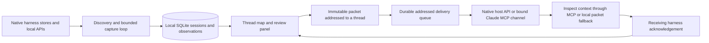

# Local thread map

The `0.4.0-dev.0` development build opens a graph at `relay ui`. It has not been published to npm; `@beta` still refers to the published release.

## Run this checkout

```sh
npm ci
npm run build
node dist/cli.js ui --data-dir /absolute/path/to/relay-map-profile
```

Use a dedicated profile when trying this development build. Its SQLite schema is version 3; older binaries refuse to open it. If a profile already has an older service running, stop it with `relay stop --data-dir PATH` before starting the new binary. No global installation is required.

## The interaction

Opening the authenticated map for the first time enables local discovery. The service finds project roots from native session metadata, registers capture connections, and indexes completed visible messages. MCP configuration is added only when you click **Enable MCP for this project**. A paused workspace stays paused across browser and service restarts.

- Drag a thread card to move it. Positions persist in the local database.
- Drag the orange connector onto another thread in the same project. The connector snaps to the destination with a generous hit area. Valid targets light up; Escape cancels. You can also click the connector, then click or keyboard-activate a destination. **+** selects multiple sources.
- Select several source threads to combine their evidence into one packet. Choose a destination, review messages, and write the continuation goal. Optional open work and project-relative file references live in the review panel.
- **Connect & send** atomically saves the reviewed checkpoint, addressed packet, and delivery request. Supported receivers receive the notification automatically. Recent source messages are selected initially; expand the message review to change them. Sending can start work in the harness under its normal permissions.
- The receiving agent uses `relay_handoff_inspect` and `relay_handoff_accept`. Targeted acceptance requires the destination's native thread ID. The graph updates from awaiting target to accepted.
- **Change destination** creates a new reviewed packet and cancels the old pending handoff atomically. Pending, undispatched connections can be cancelled. Dispatched messages cannot be recalled from a harness. Accepted handoffs cannot be rewritten.
- New captured source events, changed referenced files, or a changed Git HEAD make a pending handoff stale. Acceptance is blocked until the user reviews a fresh handoff.

The destination ID is a caller-declared routing check. An MCP connection authenticates a local project and harness, not a native chat's identity. Acceptance records the receiving harness's acknowledgement, not independently verified session identity or successful task completion. A session-bound Claude MCP receiver filters the inbox and acknowledgement to its configured native ID. This binding is still local configuration, not independent attestation by the harness. Discovery does not run a model. Explicit delivery can enqueue a new agent turn. Relay does not modify native chat databases or move project files.

## Connecting a receiver

The graph indexes stored history. A captured thread can exist while its receiving harness is closed. **Queued** means Relay is waiting for a receiver; **sent** means the transport accepted dispatch; **accepted** means the agent acknowledged the packet. None means the requested task is complete.

- **Claude Code:** open **Receiver connection** in the handoff panel. Close the existing terminal for that thread and run the displayed `relay receive --id SESSION` command once. It resumes that exact native session with a bound stdio MCP server and Claude’s `--dangerously-load-development-channels server:context_relay` opt-in. It does not bypass tool permissions or replace other MCP servers. Custom channels are a research preview and can be blocked by organization/provider policy. Relay advertises `claude/channel` and sends `notifications/claude/channel`; simply installing an ordinary MCP entry does not enable push. If the native client refuses channel registration, a transport write cannot prove model receipt; wait for the explicit agent acknowledgement. [Channel requirements](https://code.claude.com/docs/en/channels), [protocol](https://code.claude.com/docs/en/channels-reference).
- **Codex:** Relay connects to the configured loopback WebSocket or Unix socket, checks `thread/loaded/list` and the thread’s project, then calls `codex queue --remote ENDPOINT --thread NATIVE_ID`. The default is `unix://`, resolved under `CODEX_HOME` to `app-server-control/app-server-control.sock`. Set the actual running host address in **Receiver connection**. The native executable must support `queue`. Relay never resumes the thread on a second app-server. A desktop app without a reachable shared endpoint stays queued; automatic attachment to arbitrary desktop-owned chats is not implemented. [App-server protocol](https://learn.chatgpt.com/docs/app-server), [native queue](https://learn.chatgpt.com/docs/developer-commands#codex-queue).
- **OpenCode:** the capture endpoint must be the server used by the destination UI. Relay verifies the session ID/project before posting to `/session/:id/prompt_async`. Starting a separate `opencode serve` instance does not attach Relay to a different TUI’s server. [Server integration](https://opencode.ai/docs/server/).
- **Goose:** manual MCP retrieval/export remains available under **Packet & manual fallback**. Direct dispatch is not supported.

Native delivery first asks the receiving agent to inspect and accept through MCP. For an existing chat whose MCP tools have not been reloaded, it also supplies a private local Markdown packet path and a local CLI acknowledgement command. That command performs the same freshness and destination checks. No access token is placed in the prompt. Packets live under the selected Relay profile’s `deliveries/` directory with owner-only permissions.

The outbox persists across service restarts. Offline receivers are probed periodically, with source freshness rechecked immediately before dispatch. Cancelled or stale packets stop. A failed or interrupted dispatch with an unknown outcome becomes **uncertain** and is never automatically resent. Check the destination first, then explicitly retry. MCP channel claims use attempt IDs and expire to uncertain when their receipt is lost. A receiver needs reconnecting if the local service restarts.

The canvas keeps node and connector elements stable, batches pointer work into animation frames, pauses rendering of polling updates during gestures, and pans near its edges. Opening a review preserves the viewport. Cards, connector handles, multi-source selection, click-to-connect, keyboard selection, and touch pointer events share the same flow.

## Discovery and limits

The background loop scans every 15 seconds after the previous scan completes. The browser refreshes snapshots every 3 seconds while visible. These are indexed snapshots, not a model's live hidden state. The loop runs while the local service runs, including after closing the browser; **Pause background discovery** stops new imports, and `relay stop` stops the service.

| Harness | Automatic discovery | Receiving context |
| --- | --- | --- |
| Claude Code | Known transcript root under `CLAUDE_CONFIG_DIR` or `~/.claude/projects`; roots come from `cwd` | Session-bound MCP channel, enabled once with the receiver command |
| Codex | Installed CLI/app executable; paginated `thread/list`, turn metadata, and item pages | Native queue on the existing, reachable app-server that owns the loaded thread |
| OpenCode | A running loopback server at `127.0.0.1:4096`; `/project` and project-scoped session APIs | Addressed `prompt_async` on that same configured server |
| Goose | Installed CLI; JSON session list/export | Start Goose with the stdio extension command shown in Sources; the generated manifest alone does not register it |

Missing executables, an unavailable OpenCode server, unreadable sessions, and capture errors are visible in Sources or thread details. Installing a harness is different from having a discoverable local history. Remote/cloud-only histories are not included. Custom source configuration remains available in `/advanced` with explicit discovery/sync.

The collector fingerprints sources and skips unchanged captures. It captures up to 12 changed sessions per harness per pass, queues the rest, and retries failures after at least a minute. No overlapping background scans run. Threads appear before capture finishes. Claude discovery caches file metadata; malformed files are isolated so other sessions still appear. Codex uses bounded item pages, reads new items back to the last captured event on subsequent scans, and retries oversized pages one item at a time; legacy stores fall back to one complete turn per response.

Limits remain explicit: 10,000 directory entries, 2,000 Codex sessions, 200 recent Goose sessions, 100 OpenCode project roots, 16 MiB per API response or Claude JSONL record, 256 MiB per streamed Claude transcript, 64 MiB of normalized Claude context, and 20,000 normalized events per import. Source messages over 100,000 characters are stored as a labeled 96,000-character excerpt with an omission count. The marker and count travel with the evidence. A response that exceeds the transport limit still produces a visible capture error. No hidden truncation is treated as a complete transcript.

The canvas renders up to 80 matching threads at once; project/harness filters and search find other indexed threads. Up to 20 sources and 100 evidence messages can form one handoff, bounded at 1 MiB. Evidence that would exceed that budget is rejected rather than silently dropped. Incremental Codex capture rechecks its last captured event; earlier native edits or deletions are not continuously revalidated. Native histories are read only. No LLM key is needed for the map.

## Architecture



The existing checkpoint, merge, Nebius proposal, and manual adapter tools remain available in the advanced workspace. The map is the default UI; it uses the same local authenticated service and storage.

## Validation

`npm test` covers discovery, append detection, pause persistence, source failures, bounded Codex pagination, excerpts, targeted routing, atomic rewiring, freshness, and authenticated graph APIs. The real stdio MCP tests cover pushed channel notifications, bound inbox filtering and destination acknowledgement. WebSocket/HTTP transport fixtures cover live-host checks, queue dispatch, offline recovery, cancellation races and duplicate prevention; they are not live model task evaluations. `npm run test:browser` covers first-open discovery, native message updates, dragging, selection, review, acceptance, stale/cancelled states, rewiring, node persistence, mobile/dark layouts, and the advanced workflows. `npm run test:package` exercises the locally packed tarball through anonymous global and npm exec installs.
