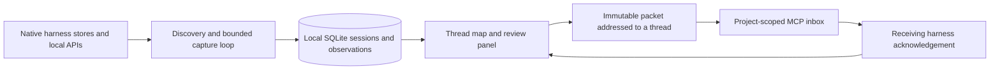

# Local thread map

The `0.4.0-dev.0` development build opens a graph at `relay ui`. It has not been published to npm; `@beta` still refers to the published release.

## Run this checkout

```sh
npm ci
npm run build
node dist/cli.js ui --data-dir /absolute/path/to/relay-map-profile
```

Use a dedicated profile when trying this development build. Its SQLite schema is version 3; older binaries refuse to open it. If a profile already has an older service running, stop it with `relay stop --data-dir PATH` before starting the new binary. No global installation is required.

## The interaction

Opening the authenticated map for the first time enables local discovery. The service finds project roots from native session metadata, registers capture connections, and indexes completed visible messages. MCP configuration is added only when you click **Enable MCP for this project**. A paused workspace stays paused across browser and service restarts.

- Drag a thread card to move it. Positions persist in the local database.
- Drag its orange output dot onto another thread in the same project to prepare a handoff. You can also select source cards with their **+** buttons and choose **Relay context**; this works without dragging.
- Select several source threads to combine their evidence into one packet. Choose a destination, review messages, and write the continuation goal. Optional open work and project-relative file references live in the review panel.
- **Create handoff** atomically saves the reviewed checkpoint and an addressed packet. Copy the continuation prompt into the destination chat. Enable the project MCP integration and reload the receiving harness's MCP connection if required.
- The receiving agent uses `relay_handoff_inspect` and `relay_handoff_accept`. Targeted acceptance requires the destination's native thread ID. The graph updates from awaiting target to accepted.
- **Change destination** creates a new reviewed packet and cancels the old pending handoff atomically. Cancelling a connection preserves its history. Accepted handoffs cannot be cancelled or rewritten.
- New captured source events, changed referenced files, or a changed Git HEAD make a pending handoff stale. Acceptance is blocked until the user reviews a fresh handoff.

The destination ID is a caller-declared routing check. An MCP connection authenticates a local project and harness, not a native chat's identity. Acceptance records the receiving harness's acknowledgement, not independently verified session identity or successful task completion. Relay does not modify native chat databases, inject a message into an active agent, move files, or run a model while discovering sessions.

## Discovery and limits

The background loop scans every 15 seconds after the previous scan completes. The browser refreshes snapshots every 3 seconds while visible. These are indexed snapshots, not a model's live hidden state. The loop runs while the local service runs, including after closing the browser; **Pause background discovery** stops new imports, and `relay stop` stops the service.

| Harness | Automatic discovery | Receiving context |
| --- | --- | --- |
| Claude Code | Known transcript root under `CLAUDE_CONFIG_DIR` or `~/.claude/projects`; roots come from `cwd` | Project `.mcp.json`, then prompt in the intended chat |
| Codex | Installed CLI/app executable; paginated `thread/list`, turn metadata, and item pages | Project `.codex/config.toml`, then prompt in the intended chat |
| OpenCode | A running loopback server at `127.0.0.1:4096`; `/project` and project-scoped session APIs | Project `opencode.json`, then prompt in the intended chat |
| Goose | Installed CLI; JSON session list/export | Start Goose with the stdio extension command shown in Sources; the generated manifest alone does not register it |

Missing executables, an unavailable OpenCode server, unreadable sessions, and capture errors are visible in Sources or thread details. Installing a harness is different from having a discoverable local history. Remote/cloud-only histories are not included. Custom source configuration remains available in `/advanced` with explicit discovery/sync.

The collector fingerprints sources and skips unchanged captures. It captures up to 12 changed sessions per harness per pass, queues the rest, and retries failures after at least a minute. No overlapping background scans run. Threads appear before capture finishes. Claude discovery caches file metadata; malformed files are isolated so other sessions still appear. Codex uses bounded item pages, reads new items back to the last captured event on subsequent scans, and retries oversized pages one item at a time; legacy stores fall back to one complete turn per response.

Limits remain explicit: 10,000 directory entries, 2,000 Codex sessions, 200 recent Goose sessions, 100 OpenCode project roots, 16 MiB per API response or Claude JSONL record, 256 MiB per streamed Claude transcript, 64 MiB of normalized Claude context, and 20,000 normalized events per import. Source messages over 100,000 characters are stored as a labeled 96,000-character excerpt with an omission count. The marker and count travel with the evidence. A response that exceeds the transport limit still produces a visible capture error. No hidden truncation is treated as a complete transcript.

The canvas renders up to 80 matching threads at once; project/harness filters and search find other indexed threads. Up to 20 sources and 100 evidence messages can form one handoff, bounded at 1 MiB. Evidence that would exceed that budget is rejected rather than silently dropped. Incremental Codex capture rechecks its last captured event; earlier native edits or deletions are not continuously revalidated. Native histories are read only. No LLM key is needed for the map.

## Architecture



The existing checkpoint, merge, Nebius proposal, and manual adapter tools remain available in the advanced workspace. The map is the default UI; it uses the same local authenticated service and storage.

## Validation

`npm test` covers discovery, append detection, pause persistence, source failures, bounded Codex pagination, excerpts, targeted routing, atomic rewiring, freshness, and authenticated graph APIs. The real stdio MCP test covers inbox filtering and destination acknowledgement. `npm run test:browser` covers first-open discovery, native message updates, dragging, selection, review, acceptance, stale/cancelled states, rewiring, node persistence, mobile/dark layouts, and the advanced workflows. `npm run test:package` exercises the locally packed tarball through anonymous global and npm exec installs.
